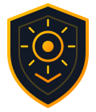

  

<h1 align="center">SUNTINEL</h1>

<strong>OSINT INVESTIGATION PLATFORM</strong>

<em>L’information mérite de la méthode.</em>

  <a href="https://ashtraysunn.github.io/suntinel-updates/">Explorer la vitrine</a> ·
  <a href="ROADMAP.md">Feuille de route</a> ·
  <a href="CHANGELOG.md">Journal des avancées</a> ·
  <a href="BRAND.md">Identité visuelle</a>

---

## Une plateforme privée pour l'investigation en sources ouvertes

SunTinel vise à aider des enquêteurs autorisés à **rechercher, recouper et documenter** des informations issues de sources ouvertes, à conserver les références et à rendre visibles les incertitudes.

**Une piste n’est jamais une preuve automatique d’identité.** La vérification et les conclusions restent humaines.

> **Bêta 0.1 · Développement privé — 24 octobre 2026.**
> Accès fermé. Cette vitrine ne permet aucune recherche de personne, aucune inscription et aucune demande d’enquête.

### Fonctions envisagées

| Point de départ | État du projet |
| --- | --- |
| Nom et prénom | Parcours évalué sur des données fictives |
| Pseudonyme | Collecteurs spécialisés en test |
| Entreprise ou association | Sources publiques étudiées |
| E-mail ou téléphone | À l’étude |
| Photo ou site internet | Piste future |

SunTinel organise les résultats d’outils spécialisés comme Sherlock, Maigret, Tavily, DDGS et certaines sources publiques d’entreprises. Aucun de ces outils n’est activé ici pour des recherches réelles. [Comprendre les recherches et les outils](OUTILS_ET_RECHERCHES.md).

## Confidentialité et avancement

- **Comptes approuvés manuellement** envisagés pour des utilisateurs autorisés, sans inscription libre.
- **Isolation des dossiers** : mêmes fonctions pour les comptes approuvés, mais pas d’accès automatique aux dossiers des autres utilisateurs.
- **Traçabilité et revue humaine** prévues pour les décisions et rapports.
- **Protection du stockage, sauvegardes et conservation** encore à qualifier.

Certains composants de sécurité des sessions et des rapports ont obtenu une **acceptation indépendante avec réserves**, limitée à leur périmètre testé.

**La création et la clôture de dossiers restent bloquées pour l’intégration.** Les derniers audits indépendants ont confirmé des améliorations, mais aussi des défauts d’autorisation nécessitant de nouveaux correctifs. Le protocole futur de clôture exige encore une décision de sécurité.

Aucune homologation, conformité générale, disponibilité du service ou date d’ouverture n’est annoncée.

[Lire le guide de sécurité et de droit](SECURITE_ET_DROIT.md) · [Consulter la feuille de route](ROADMAP.md) · [Questions fréquentes](FAQ.md).

## L'identité « Shield Beacon »

La charte SunTinel associe un **bouclier protecteur** et une **balise solaire** : investigation, protection, précision, traçabilité et confiance. Le bleu nuit profond est associé aux accents or, cyan, vert et violet.

[Voir la charte visuelle et les assets](BRAND.md).

## À propos de ce dépôt

Ce dépôt contient **uniquement la présentation publique, les visuels et les annonces de progression**. Aucun code privé, dossier d’enquête, donnée nominative, secret, rapport confidentiel ou détail de vulnérabilité exploitable n’y est publié.

SunTinel est un projet indépendant, et non un service officiel ou homologué d’une administration.

[Guide de publication](PUBLISHING.md).
